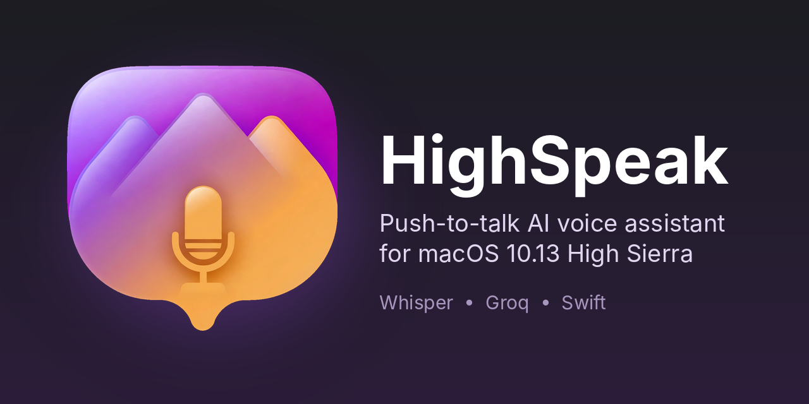

# HighSpeak

A push-to-talk voice assistant for **macOS 10.13 High Sierra**. Hold the button, talk, and HighSpeak transcribes your voice, sends it to an AI model, speaks the answer back, and shows it on screen with formatted text, tables, and code blocks.

High Sierra predates Apple's modern speech APIs (`SFSpeechRecognizer` needs 10.15, `AVSpeechSynthesizer` needs 10.14), so HighSpeak uses the [Groq](https://groq.com) API for speech recognition and the AI model, and the old `NSSpeechSynthesizer` for speaking.

> **Status: alpha.** It works on my machine; expect rough edges.

## Features

- Hold-to-talk voice input, or type a message
- Speech-to-text with Whisper (`whisper-large-v3-turbo`) and chat replies from `openai/gpt-oss-20b`, both through Groq
- Spoken replies (can be turned off); markdown is stripped before speaking, and code blocks are skipped unless you turn on **Speak Code Blocks**
- Transcript rendered in a `WKWebView`: Markdown, tables, code blocks with a Copy button, light and dark themes
- Conversation memory, restored on launch (**Chat > Clear Chat** to wipe it)
- Silent or too-short recordings are discarded instead of being sent to Whisper
- Daily-request usage indicator in the status line (from Groq's rate-limit headers)
- Settings are saved: speech on/off, speak code, voice, speech rate, theme
- API key stored in the macOS Keychain, never in the source

## Requirements

- macOS 10.13 (built and tested there; newer versions are untested)
- Xcode 10.1 (Swift 4.2) to build
- A free Groq API key from <https://console.groq.com>

## Build and run

1. Open `HighSpeak.xcodeproj` in Xcode and run.
2. On first launch, paste your Groq API key when prompted. It goes into your Keychain. Change it later with **HighSpeak > Set Groq API Key...**
3. Hold **Hold to Talk**, speak, and release.

## Notes and limitations

- Your voice recordings and messages are sent to Groq's servers. Recordings are deleted from disk after transcription.
- The conversation is saved as plain text in the app's preferences until you clear it.
- Replies come from an AI model and can be wrong. It has no live data (weather, sports, news) unless you add tools.
- The free Groq tier has request and token limits. The status line shows requests used today; there is also a tokens-per-day limit it can't show.
- High Sierra can't update its trusted root certificates easily, so if Groq ever changes certificate chains, HTTPS requests may fail on this OS.
- On macOS 10.13 there is no system dark mode, so the theme is chosen manually under **View**.

## Credits

- [Groq](https://groq.com) for the API; OpenAI's open-weight `gpt-oss` and Whisper models
- [marked](https://github.com/markedjs/marked) (MIT) renders Markdown; see [THIRD_PARTY_NOTICES.md](THIRD_PARTY_NOTICES.md)

## License

MIT. See [LICENSE](LICENSE).

## Artwork

The app icon was generated with Meta AI.
